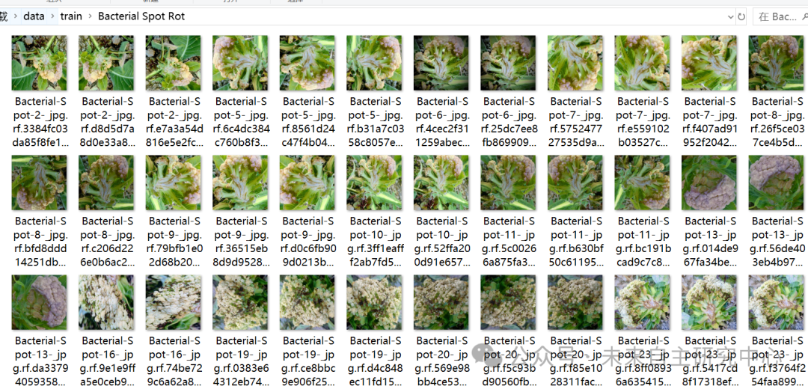
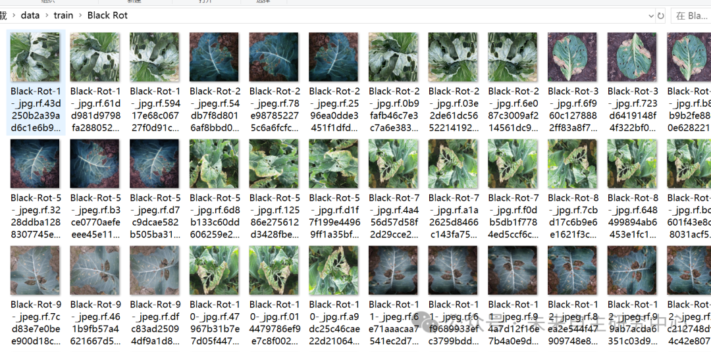
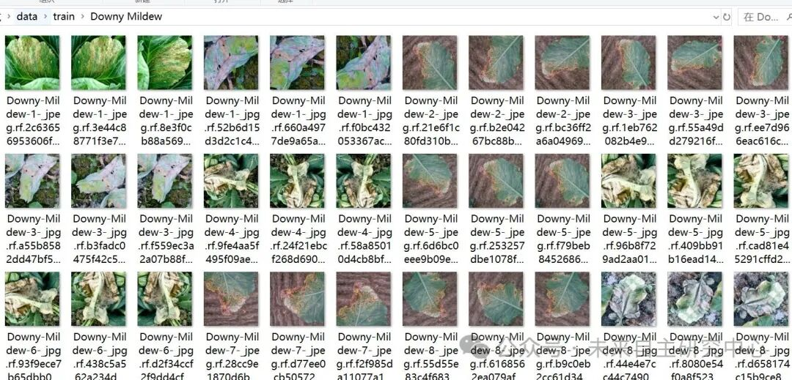
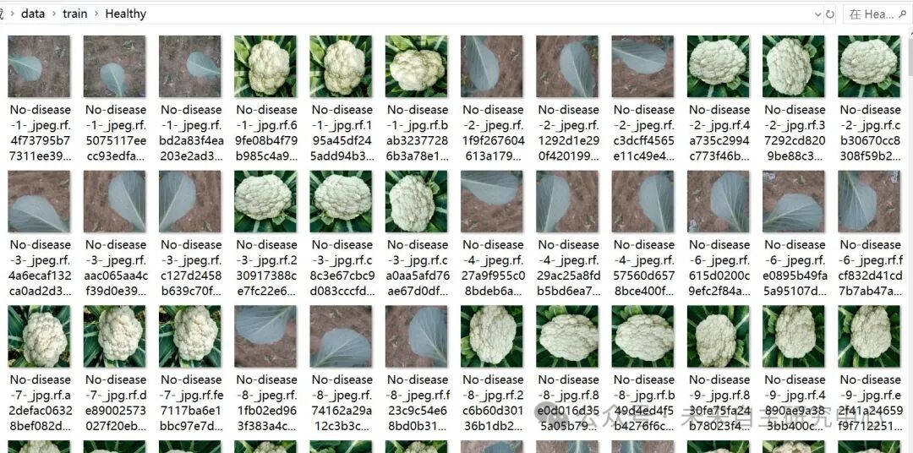

# Cauliflower Disease Classification Dataset - 1504 Images in 4 Categories

Dataset type: Image classification, not for object detection without annotations.

Dataset format: Only contains jpg images, each category folder contains the corresponding image.

Number of images (number of jpg files): 1504

Category: 4

Category Name: ["Bacterial Spot Rot", "Black Rot", "Downy Mildew", "Healthy"]

Number of images per category:

Bacterial Spot Rot image count: 393

Black Rot 230

Downy Mildew 396 images

Healthy Image count: 485

Important Notice: No

Special : This dataset does not guarantee the accuracy of the trained models or weight files, and it only provides accurate and reasonable classification storage.

Image Preview:

## Payment

Here is a pay link on Stripe ( https://buy.stripe.com/3cs8yP7sY87d0vu9AB ). Please contact me lonlonago@foxmail.com after funding $89, and I will send you a complete data files , thank you!

